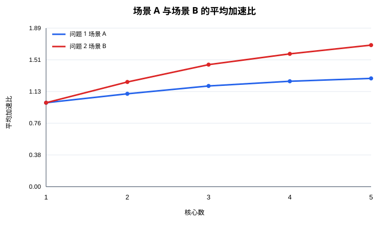
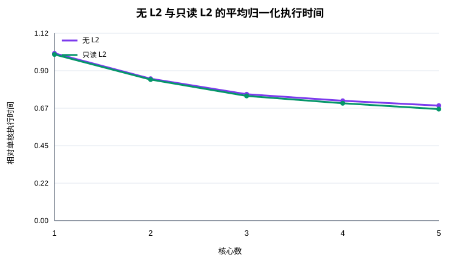

# 通用神经网络处理器下的多核调度建模报告

## 摘要

本文研究同构多核 NPU 上计算图的切分、核心分配与核内执行次序问题。该问题同时受有向无环数据依赖、四类硬件流水线、私有 L1/UB 容量、共享 DDR 带宽以及跨核同步延迟约束。针对三种评测场景，本文提出通信感知的分层拓扑聚合与关键路径列表调度算法：先将 Op–Tensor 二部图收缩为操作 DAG，以静态底层长度生成关键路径优先的拓扑序；再按累计工作量聚合为连续拓扑块；最后用综合 Pipe 负载、前驱完成时间、跨核同步延迟和张量传输量的最早完成时间准则完成分核。问题 1 使用较粗粒度切分以控制 Task 切换和 DDR 中转，问题 2、3 使用较细粒度切分以提高场景 B 的并行性，问题 3 沿用问题 2 的方案以保证 L2 对比公平。

在固定配置下对全部 100 个正式用例、1–5 核进行官方评测，共得到 500 组完整结果，失败数为 0。五核时，问题 1 和问题 2 的平均加速比分别为 1.2902 和 1.6868；问题 2 在 86% 的用例上优于问题 1。只读 L2 在五核时相对无 L2 的平均加速比为 1.0384，平均字节命中率为 12.74%。结果表明：场景 B 的同核驻留复用是提升多核效率的主要来源；只读 L2 的收益随核数和共享输入机会增加而增强，但 FIFO 容量、读带宽竞争和事件相位变化使少量案例出现轻微负收益。

**关键词：** 计算图切分；多核调度；关键路径；列表调度；共享带宽；缓存复用

## 1 问题重述

给定一张 Op–Tensor 二部 DAG，需要为全部非 `COPY_IN/COPY_OUT` 操作确定子图编号，为每个子图选择一个 NPU 核，并给出各核子图顺序。评价程序随后自动重建 Task 边界 COPY、执行核内拓扑排序、在 L1/UB 不足时插入换出换入，并在共享带宽下离散事件模拟得到 Makespan。

三个问题的差异为：

1. 场景 A 中一个子图就是一个 Task。Task 之间不保留片上数据，同核 Task 切换等待 100 cycles，跨核前驱等待 1000 cycles。
2. 场景 B 中同一核的全部子图合并为一个 Task。同核依赖直接保留片上数据，跨核 COPY 的同步延迟为 500 cycles。
3. 在场景 B 上增加 1 MiB、250 bytes/cycle 的只读 FIFO L2；Cache 读与 DDR 的 60 bytes/cycle 带宽互相独立。

主目标是最小化 Makespan，次目标是控制新增 DDR 搬运量，并比较只读 L2 对时延的影响。

## 2 模型假设与符号

### 2.1 基本假设

1. 输入图、节点属性和固定配置均以题目文件为准，不修改容量、带宽或同步延迟。
2. 每个核心同构；同一核心每条 Pipe 同时执行一个操作，不同 Pipe 可在依赖满足时重叠。
3. 计算操作耗时等于 `cycles`；DDR 搬运实际耗时由评价程序按共享带宽统一重算。
4. 切图只决定非 COPY 操作的子图归属；所有边界 COPY、换出和换入均由官方程序自动插入。
5. 问题 2 与问题 3 使用完全相同的切分及分核结果，从而将 Makespan 差异归因于只读 L2。

### 2.2 主要符号

| 符号 | 含义 |
|---|---|
| $G=(V_O,V_T,E)$ | Op–Tensor 二部计算图 |
| $G_O=(V,A)$ | 收缩 tensor 与原始 COPY 后的非 COPY 操作 DAG |
| $m$ | 核心数，$m\in\{1,2,3,4,5\}$ |
| $c_v$ | 操作 $v$ 的计算周期 |
| $s_{uv}$ | 操作依赖 $(u,v)$ 携带的张量字节数 |
| $B$ | DDR 总带宽，固定为 60 bytes/cycle |
| $D_A,D_B$ | 场景 A、B 的跨核延迟，分别为 1000、500 cycles |
| $d_{bp}$ | 子图块 $b$ 在 Pipe $p$ 上的周期和 |
| $F_b$ | 子图块 $b$ 的估计完成时刻 |
| $x_{bk}$ | 子图块 $b$ 是否分配到核心 $k$ |

## 3 数学模型

### 3.1 操作 DAG 与通信权重

将路径 `op → tensor → op` 收缩为操作依赖边；跨过原始 COPY 节点时保留最近非 COPY 操作间的可达依赖。对每对操作依赖，累加相连 tensor 的大小：

$$
s_{uv}=\sum_{t:\,u\to t\to v}\operatorname{size}(t).
$$

该权重既反映切分后的潜在 DDR 流量，也参与跨核最早释放时间估计。

### 3.2 主目标与次目标

设全部操作的实际完成时刻为 $C_v$，则

$$
\min T_{\max},\qquad T_{\max}=\max_{v\in V_O}C_v.
$$

在 Makespan 接近时，偏向较少的跨核字节数：

$$
\min M_{\text{cross}}=\sum_{(u,v)\in A}s_{uv}\,[\operatorname{core}(u)\ne\operatorname{core}(v)].
$$

实际求解采用“估计完成时刻优先、通信量仅作同分决策”的字典序准则，最终指标均由官方评测器给出，而不是由上述近似模型替代。

### 3.3 约束

1. **唯一归属：** 每个非 COPY 操作恰好属于一个子图，每个子图恰好调度一次。
2. **拓扑约束：** 若 $u\leadsto v$，则同核调度中包含 $u$ 的子图不得晚于包含 $v$ 的子图。
3. **Pipe 互斥：** 同核同 Pipe 操作区间不得重叠。
4. **缓存容量：** 任意时刻每核 L1 与 UB 驻留量分别不超过 524288 与 131072 bytes；不足时允许官方算法插入 spill。
5. **共享带宽：** 同时访问 DDR 的搬运公平共享 60 bytes/cycle；问题 3 的 Cache read 独立共享 250 bytes/cycle。

## 4 求解算法

### 4.1 关键路径优先拓扑序

定义操作的静态底层长度

$$
L(v)=c_v+\max_{w\in\operatorname{succ}(v)}L(w),
$$

叶节点的后继最大值取 0。使用 Kahn 算法维护入度为 0 的操作，并以 $(-L(v),\operatorname{id}(v))$ 为优先级。这样可优先暴露关键路径，同时保持确定性和可复现性。

### 4.2 连续拓扑块

将上述拓扑序按累计周期切为近似等重的连续块。连续拓扑区间具有一个重要性质：所有跨块依赖都从较小块编号指向较大块编号，因此子图依赖图必为 DAG，无需事后破环。

问题 1 设目标块数为 $6m$，减少 Task 边界 COPY 与 100/1000-cycle 等待；问题 2、3 设目标块数为 $24m$，在同核可驻留复用的前提下增加分核自由度。单核时均使用一个块，以匹配单核基准。

### 4.3 通信感知列表调度

对子图块 $b$ 依次选择使估计完成时间最小的核心。若候选核心为 $k$，其最早释放时刻为

$$
r_{bk}=\max\left\{A_k+g,\ \max_{a\in\operatorname{pred}(b)}\left[F_a+I(k_a\ne k)\left(D+\frac{s_{ab}}{B}\right)\right]\right\},
$$

其中 $A_k$ 为核心当前完成时刻；场景 A 中同核非首 Task 的 $g=100$，场景 B 中 $g=0$；$D$ 分别取 1000 或 500。结合四条 Pipe 的可用时刻 $A_{kp}$，估计完成时刻为

$$
\widehat F_{bk}=\max_{p}\left(\max\{A_{kp},r_{bk}\}+d_{bp}\right).
$$

选择 $\widehat F_{bk}$ 最小的核心；若相同，则选择新增跨核字节更少者，再按核心编号确定性破平局。分配后更新该核心的 Pipe 可用时刻和块完成时刻。

### 4.4 问题 3 的处理

问题 3 不重新切图，而是复用问题 2 的方案。官方模拟器在 `COPY_IN` 发射时以逻辑 tensor id 查询 FIFO Cache：命中走独立 Cache read 池，未命中访问 DDR 并在完成后插入 Cache。此设计避免“为 Cache 特调方案”造成的不公平基线，同时可直接测量 L2 的净收益。

### 4.5 正确性与复杂度

连续拓扑分块保证子图依赖无环；每个操作仅映射一次，每个块仅放入一个核心列表一次，因此满足覆盖与唯一性。同核列表按块编号递增，任何同核依赖均从前向后，不违反拓扑。缓存、Pipe 和共享带宽的最终可执行性由官方核内调度与事件模拟再次校验；500 组方案全部通过。

操作 DAG 构造为 $O(|V|+|E|)$，关键路径和堆式拓扑排序为 $O((|V|+|E|)\log |V|)$。块数至多 $24m\le120$，列表调度开销远小于图遍历。算法存储复杂度为 $O(|V|+|E|)$。

## 5 实验设计

### 5.1 配置与指标

实验使用题目固定配置：L1 524288 bytes、UB 131072 bytes、DDR 60 bytes/cycle；场景 A 跨核/同核等待为 1000/100 cycles；场景 B 跨核同步延迟为 500 cycles；只读 L2 容量 1 MiB、带宽 250 bytes/cycle。

对 100 个正式案例逐一运行 1–5 核。加速比按

$$
S_m=\frac{T_{1,\text{singlecore}}}{T_m}
$$

计算；L2 相对无 L2 的加速比为 $T_{m,\text{no-L2}}/T_{m,\text{L2}}$。表中“平均”均为 100 个逐案例比值的算术平均，避免大图的绝对周期数支配结论。

### 5.2 评测实现的等价性能优化

原评测代码在核内 Step3 的每个事件轮次扫描全部操作判断是否结束，场景 A 还会再次扫描当前 Task 的全部操作，在数万节点图上形成 $O(|V|^2)$ 的状态检查。本文将两处检查等价替换为“未完成操作计数器”，没有修改任何依赖、发射、带宽或时间推进规则。优化前后在 `case_001`、`case_002` 的 1–5 核三问结果 CSV 逐字节一致；随后才运行全量实验。

## 6 结果与分析

### 6.1 问题 1 与问题 2

| 核数 | 问题1平均加速比 | 问题2平均加速比 | 问题1平均新增搬运 MiB | 问题2平均新增搬运 MiB | 问题1优于单核案例数 | 问题2优于单核案例数 | 问题2优于问题1案例数 |
|---:|---:|---:|---:|---:|---:|---:|---:|
| 1 | 1.0000 | 1.0000 | 11.842 | 11.842 | 0 | 0 | 0 |
| 2 | 1.1070 | 1.2476 | 26.781 | 28.707 | 62 | 84 | 73 |
| 3 | 1.2001 | 1.4543 | 28.937 | 30.815 | 61 | 88 | 78 |
| 4 | 1.2562 | 1.5829 | 31.821 | 32.220 | 61 | 91 | 82 |
| 5 | 1.2902 | 1.6868 | 33.138 | 33.928 | 64 | 92 | 86 |



问题 2 在 2–5 核均显著优于问题 1，且优势随核数扩大。五核平均加速比由 1.2902 提高至 1.6868，说明场景 B 的同核跨子图驻留复用和较低同步代价能够有效缓解 Task 边界开销。问题 2 五核在 92 个案例中快于单核，并在 86 个案例中快于问题 1。

加速比明显低于理想线性值，原因有三：第一，DDR 总带宽不随核心数增加；第二，操作 DAG 的关键路径限制可并行度；第三，跨核边界和 spill 随切分增加。平均新增搬运量随核数上升，说明本算法确实在用更多通信换取并行。单核仍有 11.842 MiB 的平均新增搬运，这是容量不足导致的 spill，而不是多核切分产生的通信。

问题 1 的最佳结果出现在 `case_021` 五核，加速比 2.9081；问题 2 的最佳结果出现在 `case_027` 五核，加速比 3.4378。个别案例问题 1 优于问题 2，说明长生命周期张量在场景 B 中持续占据私有缓存时，合并 Task 可能增加 spill，抵消同核复用收益。

### 6.2 问题 3

| 核数 | 无L2平均归一化时间 | 只读L2平均归一化时间 | L2相对无L2平均加速比 | 平均字节命中率 |
|---:|---:|---:|---:|---:|
| 1 | 1.0000 | 0.9931 | 1.0086 | 9.20% |
| 2 | 0.8484 | 0.8431 | 1.0058 | 7.61% |
| 3 | 0.7556 | 0.7453 | 1.0152 | 10.01% |
| 4 | 0.7165 | 0.7017 | 1.0251 | 11.34% |
| 5 | 0.6876 | 0.6665 | 1.0384 | 12.74% |



只读 L2 的平均收益整体随核数提高：核心越多，同一逻辑输入被不同核心或不同换入操作重复访问的机会越多，FIFO Cache 更容易覆盖这些读请求。单核也存在 1.0086 的平均收益，因为 spill 后的重复 `COPY_IN` 可能命中 L2 中的 backing tensor。

在 400 组多核对比中，L2 改善 276 组、持平 115 组、变差 9 组。多核最佳收益为 `case_037` 五核的 1.3841；全体最佳为 `case_044` 单核的 1.4322。最差为 `case_021` 五核的 0.9945，仅下降约 0.55%。轻微负收益并不表示命中增加了单次访问时延，而是 Cache read 共享、DDR/Cache 两个池的事件相位变化和 Pipe FIFO 共同改变后续发射顺序；因此，仅以命中率判断端到端收益并不充分。

## 7 敏感性、优缺点与改进方向

### 7.1 粒度敏感性

块数过少会降低并行度；块数过多会增加边界 COPY、同步和核内调度开销。本文以 $6m$ 与 $24m$ 区分场景，是稳健但非逐图最优的设置。可在候选集合 $\{4m,6m,8m,12m,24m,32m\}$ 上做小规模试评，选择预测 Makespan 最小者。

### 7.2 模型优点

1. 合法性由构造保证，不需要昂贵的破环修复。
2. 同时考虑关键路径、Pipe 负载、跨核延迟和字节量，而不是只做平均分配。
3. 算法确定、复杂度近线性，能够处理近 4 万操作的正式图。
4. 三问共享统一框架，问题 3 与问题 2严格同方案对比。

### 7.3 模型局限

1. 列表调度使用近似 Pipe 完成时刻，没有在搜索阶段完整模拟 DDR 公平共享。
2. 连续拓扑块保证合法性，但限制了非连续、强数据复用节点的聚合。
3. 场景 B 中将同核块完成时刻保守串行更新，没有充分预测核内跨 Pipe 重叠。
4. 问题 3 没有把 FIFO 驻留距离直接纳入分核目标，因此命中率仍有提升空间。

### 7.4 可继续优化的方法

可先用本文方案生成可行解，再进行局部搜索：对子图块执行相邻合并、拆分、换核和顺序交换，每次用轻量增量成本筛选，只对候选优解调用官方评测器。问题 3 可增加 reuse-distance 特征，把预计在 1 MiB FIFO 窗口内再次访问的共享输入作为负通信成本；同时对少数 L2 负收益案例设置回退策略，直接采用无 L2 时间更短的配置。

## 8 结论

本文给出了可复现、可扩展且通过全部官方案例的多核切图与调度方案。全量实验说明：增加核心数能持续降低平均执行时间，但共享 DDR、关键路径与新增搬运使收益明显次线性；场景 B 的同核驻留复用比单纯增加场景 A 的 Task 并行更有效；只读 L2 的平均收益虽不大，却随核心数增长，并在共享输入明显的案例中达到 38% 以上。后续优化的重点应从“单纯平衡计算量”转向“联合控制关键路径、跨核字节、spill 与 Cache 复用距离”。

## 9 复现说明

生成单个方案：

```powershell
python code/solution_multicore.py data/case_001.json -n 4 -p 1 -o case_001_p1_plan.json
python code/solution_multicore.py data/case_001.json -n 4 -p 2 -o case_001_p2_plan.json
```

运行全量实验与汇总：

```powershell
python code/run_experiments.py --output-dir analysis_results/full
python code/summarize_results.py
```

完整的 500 行逐用例结果见 [全部用例评估明细](analysis_results/full/全部用例评估明细.md)，机器可读数据见 [CSV](analysis_results/full/all_results.csv) 和 [JSON](analysis_results/full/all_results.json)。

## 参考材料

1. 赛题文档《通用神经网络处理器下的多核调度问题》及附录 A–D。
2. 附件 `docs/核内调度算法.md`。
3. 附件 `docs/多核并行模拟执行算法.md`。
4. 官方评测脚本 `multicore_cut_evaluate_problem_1.py`、`multicore_cut_evaluate_problem_2.py`、`multicore_cut_evaluate_problem_3.py`。
